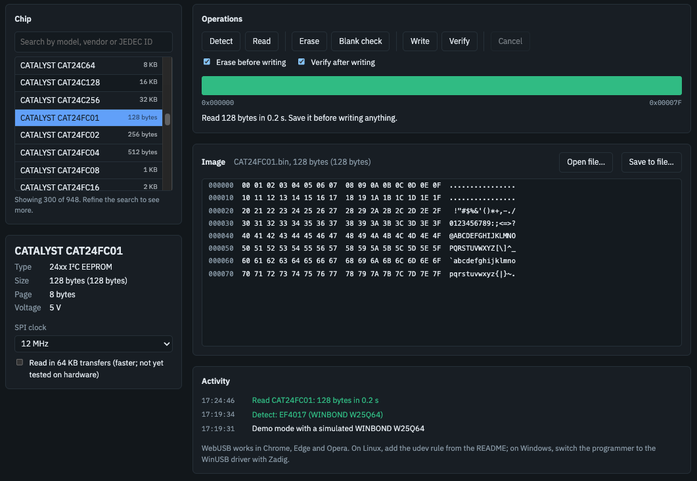

# openEZP2023

_Note: I was bored of running a Windows VM to run my EZP2023+ programmer software, so I asked Claude to recreate it.
I take no pride in it, it just works. Sometimes that's all you want._



A cross-platform replacement for the Windows-only **EZP2023+** programmer
software: a Go package that speaks the programmer's USB protocol, compiled
to WebAssembly and driven from the browser through WebUSB.

The protocol was reverse-engineered statically from the vendor software
(`EZP2023+.exe` v3.0). See [docs/PROTOCOL.md](docs/PROTOCOL.md).
**It has not been tested on real hardware yet.**

## Layout

| Path | What it is |
|---|---|
| `ezp/` | Core package: chip database, packet encoding, `Programmer` (detect, read, erase, blank check, write, verify). No dependencies, no I/O of its own. |
| `ezpmock/` | Simulated programmer firmware. Used by the tests and by the UI's demo mode. |
| `webusb/` | `ezp.Transport` over the browser WebUSB API (`js/wasm` only). |
| `cmd/ezp-wasm/` | WASM entry point. Exposes a Promise-based `globalThis.ezp` API to JavaScript and embeds the chip database. |
| `web/` | The browser UI (`index.html`, `app.js`) plus the built `ezp.wasm`. |
| `cmd/ezp-serve/` | Optional: single binary that serves the UI on `http://127.0.0.1:8023`. |
| `deploy/` | Web server configuration (Apache `.htaccess`, nginx). |

Any other transport (for example a native one on top of libusb/gousb for a
CLI) only has to implement the five methods of `ezp.Transport`.

## Build

Requires Go 1.22+.

```sh
make dist   # static site in dist/, ready to upload
make        # builds web/ezp.wasm and bin/ezp-serve (local use)
make test   # unit tests against the simulated firmware
```

## Running locally

Simply run:

    python3 -m http.server 8000 --bind 127.0.0.1 -d dist

and connect to http://127.0.0.1:8000/ (using a webUSB compatible browser).


## Hosting on a web server

The tool is a static site: nothing runs on the server, all USB traffic
stays in the visitor's browser. Upload the **contents** of `dist/` to any
web server (Apache, nginx, shared hosting, GitHub Pages, Netlify, S3...).

- **HTTPS is required.** Browsers only expose WebUSB on secure pages. Over
  plain HTTP the page loads and the demo works, but "Connect programmer"
  stays disabled. `http://localhost` is the only exception.
- **Apache / shared hosting**: `dist/.htaccess` declares the `.wasm` type,
  enables compression (2.6 MB to about 730 KB), sets caching and redirects
  to HTTPS. It needs `AllowOverride All` (the default on most shared hosts).
- **nginx**: see `deploy/nginx.conf`.
- If the server sends `.wasm` with the wrong type, the page still loads
  (a little slower); compression is what matters most for load time.
- Every `make dist` adds a version suffix (`app.js?v=...`), so visitors get
  the new version after an update without mixing old and new files.
- The page makes no third-party requests: fonts are served from `fonts/`
  (IBM Plex, SIL Open Font License, see `fonts/OFL-LICENSE.txt`).
- If you embed the page in an `<iframe>`, add `allow="usb"` to it.
- Opening `index.html` directly from disk (`file://`) does not work.

## Operating system setup

The programmer is VID `0x1FC8`, PID `0x310B`.

**Linux**: give your user access to the device, then replug it.

```sh
echo 'SUBSYSTEM=="usb", ATTR{idVendor}=="1fc8", ATTR{idProduct}=="310b", MODE="0660", TAG+="uaccess"' \
  | sudo tee /etc/udev/rules.d/60-ezp2023.rules
sudo udevadm control --reload-rules
```

**macOS**: nothing to do.

**Windows**: the vendor installs `libusb0.sys`, which Chrome cannot use.
With [Zadig](https://zadig.akeo.ie/), select the EZP2023+ and replace its
driver with **WinUSB**. The vendor software will not work until you
reinstall its driver.

## The JavaScript API

All operations return Promises and run one at a time.

```js
ezp.chips                         // [{index, vendor, model, size, page, protocol, jedec}]
await ezp.connect()               // device picker; call from a click handler
await ezp.reconnect()             // previously allowed device, or null
await ezp.connectDemo(chipIndex)  // simulated programmer
await ezp.detect(chipIndex?)      // {bus, busName, jedec, matches: [chipIndex]}
await ezp.read(chipIndex, onProgress)            // Uint8Array
await ezp.erase(chipIndex, onProgress)
await ezp.blankCheck(chipIndex, onProgress)      // {ok, offset}
await ezp.write(chipIndex, uint8array, onProgress)
await ezp.verify(chipIndex, uint8array, onProgress) // {ok, offset}
ezp.cancel(); ezp.setClock(0..5); ezp.setReadChunk(bytes)
```

## Known gaps

- `Write` follows the vendor software: it does not erase by itself (the UI
  offers "Erase before writing") and skips trailing `0xFF` bytes.
- Reading uses page-sized transfers like the vendor software. The UI option
  "Read in 64 KB transfers" is much faster over WebUSB but is a guess.
- `ezp.wasm` embeds the vendor's chip database (`EZP2023+.Dat`). Check its
  licence before hosting the tool publicly; a private or
  password-protected location avoids the question.
